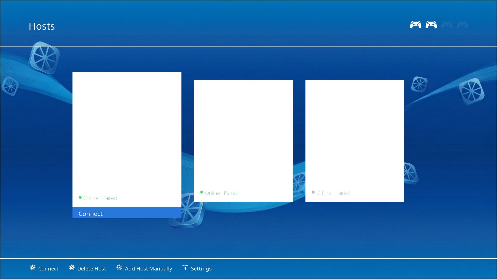
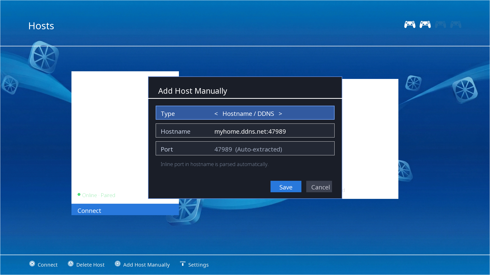
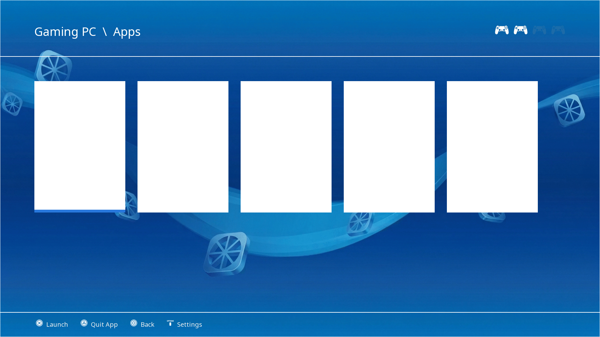

# Moonlight MP for PlayStation 4

**Moonlight MP** is an enhanced, open-source Moonlight Game Streaming client for jailbroken PlayStation 4 and PS4 Pro consoles. Built for local co-op and remote streaming, it brings **4-player multiplayer support**, **dual-motor rumble**, **dynamic light bar feedback**, **active controller indicators**, **DDNS/hostname manual pairing**, and **isolated side-by-side storage**.

> Developed and maintained by **[natko](https://github.com/natkokrasevac/moonlight-mp-ps4)**. Based on the original **Moonlight DX for PlayStation 4** by [Four Letter Workshop](https://fourletterworkshop.com/projects/moonlight_dx_for_playstation_4).

---

## Features

### 🌟 New in Moonlight MP

- **Multi-Controller & Local Co-Op (MP)**: Connect up to 4 DualShock 4 controllers simultaneously for local multiplayer gaming. Secondary controllers are detected dynamically as users or guest accounts sign in (`sceUserServiceGetLoginUserIdList`). Automatically provisions virtual controllers on the host (`&remoteControllersBitmap=15&gcmap=15`).
- **250 Hz High-Frequency Input & Motion Engine**: Runs input polling and motion sensor streaming on a dedicated background thread at a 4 ms cadence (250 Hz) for minimal latency and high-frequency gyroscope reports.
- **Dual-Slot Touchpad Gestures & Smooth Scrolling**:
  - **1-Finger Drag**: Smooth mouse cursor movement with float sub-pixel accumulators.
  - **2-Finger Scroll**: Vertical and horizontal high-resolution scrolling (`LiSendHighResScrollEvent`).
  - **Dual Clicks**: 1-finger click = Left Click, 2-finger click = Right Click (retaining `Cross` and `Circle` as clicks).
- **Gyroscope & Accelerometer (IMU) Motion Passthrough**: Full 6-axis motion reporting (`vel` and `acell` converted to deg/s and m/s²) with dynamic Sunshine/Steam Input activation via `setMotionEventState`.
- **DualShock 4 Touchpad & Split Mapping**: In normal gamepad mode, clicking the left half of the touchpad sends Select / Back (`BACK_FLAG`), while the right half sends the native PS4 touchpad button (`TOUCHPAD_FLAG`).
- **Radial Analog Stick Deadzones**: Configurable radial scaling (0%, 5%, 8% default, 10%, 15%, 20%) in settings eliminates stick drift without step jumps.
- **Host Face Button Swapping**: In-stream button swap (`Cross` ↔ `Circle`, `Square` ↔ `Triangle`) for Japanese/Nintendo button layouts without affecting PS4 UI navigation.
- **Automatic Stream Reconnection & Health Feedback**: Automatically reconnects up to 3 times on unexpected connection drops, shows in-stream poor-connection warning banners, and displays live status on game cards.
- **Live Controller HUD Indicators**: Real-time top-bar indicators show connected vs. standby controllers (1–4) across all menus with native DualShock 4 icons.
- **Dual-Motor Force Feedback (Rumble)**: Hardware dual-motor vibration (`largeMotor` heavy rumble and `smallMotor` light rumble via `scePadSetVibration`) routed independently to each player slot.
- **Dynamic In-Game RGB Light Bar Colors**: Real-time game-driven light bar illumination (`clSetControllerLED`), reverting cleanly to player slot colors (P1: **Blue**, P2: **Red**, P3: **Green**, P4: **Magenta**) in menus or on disconnect.
- **Hostname & DDNS Support with Smart Port Parsing**: Add remote PCs using domain names/DDNS (e.g. `myhome.ddns.net`) alongside numeric IPv4. Automatically extracts inline ports (e.g. `hostname:port`) and resolves DNS dynamically upon stream connection.
- **Independent Storage & Zero-Friction DX Import**: Moonlight MP maintains its own storage directory (`/data/moonlight-mp/`), allowing it to run alongside Moonlight DX without settings or pairing collisions. Automatically imports existing DX pairings on first launch so no re-pairing is needed.
- **Stream Startup & IDR Recovery Fix**: Fixed black-screen hangs on stream startup with hosts or game engines that do not emit immediate IDR keyframes upon connection.
- **Universal Stream Exit**: Press `Options + L3` on any connected controller to gracefully exit the stream back to the UI.
- **Reproducible Docker Build**: Cross-compile the PS4 `.pkg` on Windows, Linux, or macOS with a single command (`.\build-docker.ps1`) without installing toolchains locally.

### 🛡️ Inherited from Moonlight DX

- **PS4 Pro 4K & HEVC Support**: Hardware-accelerated H.265/HEVC decoding with a true 4K streaming pipeline on PS4 Pro.
- **Full GPU Acceleration**: Hardware video decoding and GPU-accelerated UI rendering/compositing for low latency and cool console operation.
- **Touchpad Mouse Emulation**: Touchpad on Controller 1 emulates mouse cursor navigation and clicks.
- **Hardware Keyboard & Mouse**: Direct pass-through support for USB/Bluetooth keyboards and mice.
- **PlayStation-Inspired UI**: Clean native interface with choice between classic Grid and PlayStation CrossBar views.
- **mDNS Auto-Discovery**: Automatic discovery and pairing with local Sunshine and GeForce Experience hosts.

---

## Screenshots

<p align="center">
  
  <br>
  <em>Host List carousel with active controller HUD indicators (top right) and live online/offline host status.</em>
</p>

<p align="center">
  
  <br>
  <em>Manual Host Add dialog featuring Hostname / DDNS mode and automatic inline port parsing.</em>
</p>

<p align="center">
  
  <br>
  <em>Application & Game catalog grid view with player connection status.</em>
</p>

---

## Installation

1. Download the latest `moonlight-mp-ps4_*.pkg` from [Releases](https://github.com/natkokrasevac/moonlight-mp-ps4/releases).
2. Copy the `.pkg` file to the root of a USB flash drive formatted as **FAT32** or **exFAT**.
3. Plug the drive into your PS4 and install via the **GoldHEN Package Installer**.
   *(Alternatively, upload via FTP to `/data/pkg/` on your console).*

---

## Building from Source

### Using Docker (Recommended for Windows, macOS, Linux)

A preconfigured Docker builder environment is included so you don't need to manually configure the PS4 cross-compilation toolchain.

**Windows (PowerShell):**
```powershell
.\build-docker.ps1
```

**Manual Docker command:**
```bash
# Build the builder image (one time)
docker build -t moonlight-ps4-builder -f Dockerfile.builder .

# Compile and package the PKG
docker run --rm -v "${PWD}:/workspace" -w /workspace moonlight-ps4-builder make all
```

### Native Toolchain (macOS / Linux)

Prerequisites:
- [OpenOrbis Toolchain](https://github.com/OpenOrbis/OpenOrbis-PS4-Toolchain) v0.5.4 (`$OO_PS4_TOOLCHAIN`)
- [OpenGNM](https://github.com/OpenOrbis/opengnm) installed into the toolchain sysroot
- Clang 18+, LLD, CMake >= 3.18

```bash
git clone --recursive https://github.com/natkokrasevac/moonlight-mp-ps4.git
cd moonlight-mp-ps4
make
```

---

## Controls

### Navigation & Menus

| Action | Control |
|---|---|
| **Navigate UI** | D-Pad / Left Stick |
| **Select / Enter** | ✕ Cross (or ○ Circle based on console setting) |
| **Back / Cancel** | ○ Circle (or ✕ Cross based on console setting) |
| **Open Settings Overlay** | Options (in menus) |
| **Open Help & Shortcuts** | Touchpad Click (in menus) |
| **Toggle Hostname / IP** | ▢ Square (in Add Host modal) |

### In-Stream Controls (Normal Gamepad Mode)

| Action | Control |
|---|---|
| **Game Pause / Start** | Options |
| **Select / View / Back** | Touchpad Click (Left half) |
| **Native DualShock 4 Touchpad Button** | Touchpad Click (Right half) |
| **Host PS / Guide Button / Steam Overlay** | `L1 + R1 + Options` |
| **Exit Stream to Menu** | Hold `Options + L3` for 1 sec (any controller) |
| **Toggle Mouse Emulation Mode** | `Options + Touchpad Click` (Player 1) |

### Mouse Emulation Controls (when Mouse Mode is ON)

| Action | Control |
|---|---|
| **Move Cursor** | 1 finger drag on Touchpad or Left Stick |
| **Left Click** | 1-finger Touchpad click or ✕ Cross |
| **Right Click** | 2-finger Touchpad click or ○ Circle |
| **Middle Click** | R3 (Right stick click) |
| **Scroll (Vertical & Horizontal)** | Drag 2 fingers on Touchpad |
| **Accelerate Cursor** | Hold R2 while moving |

---

## Credits & License

- Developed and maintained by **[natko](https://github.com/natkokrasevac/moonlight-mp-ps4)**.
- Based on the original Moonlight DX for PS4 by **[Four Letter Workshop](https://fourletterworkshop.com/projects/moonlight_dx_for_playstation_4)**.
- Powered by [moonlight-common-c](https://github.com/moonlight-stream/moonlight-common-c).
- Open source under the [GNU General Public License v3.0](LICENSE).
